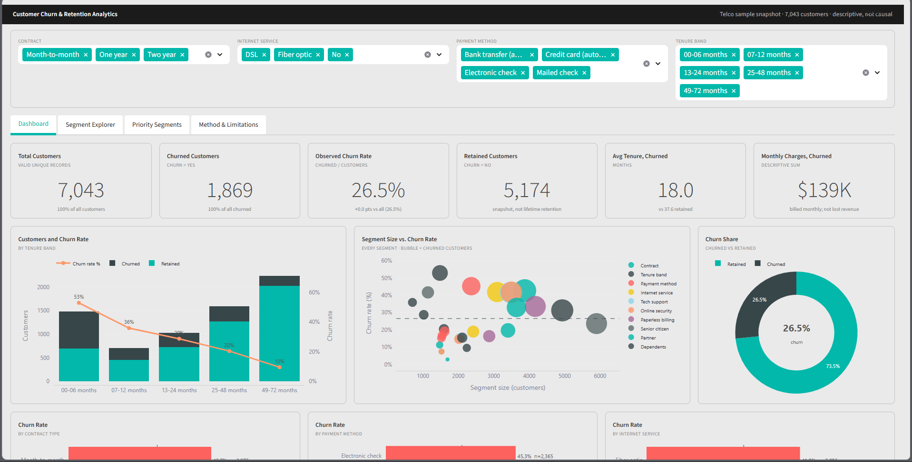

# Customer Churn & Retention Analytics

Dari 7.043 pelanggan telekomunikasi, **1 dari 4 berhenti berlangganan**. Proyek ini mencari *siapa* mereka: kelompok pelanggan mana yang paling sering pergi, dan seberapa besar kelompok itu, supaya tim retensi tahu harus menyelidiki ke mana dulu.

Semuanya dikerjakan di laptop dengan Python saja: satu notebook untuk analisis, satu dashboard web untuk menjelajahi hasilnya. Tanpa database, tanpa Power BI.



## Masalah yang ingin dijawab

Perusahaan telekomunikasi kehilangan pelanggan setiap bulan, sementara tim retensi punya waktu dan anggaran terbatas. Pertanyaannya bukan sekadar "berapa persen yang churn?", tapi:

- Kelompok mana yang churn-nya jauh di atas rata-rata?
- Apakah kelompok itu cukup besar untuk layak diprioritaskan, atau cuma kecil tapi angkanya terlihat tinggi?
- Hal apa yang perlu diselidiki lebih lanjut sebelum membuat program retensi?

## Apa yang ditemukan

Churn keseluruhan **26,54%** (1.869 dari 7.043 pelanggan).

| Kelompok | Pelanggan | Churn | Porsi dari seluruh churn |
|---|---:|---:|---:|
| Tenure 0–6 bulan | 1.481 | **52,9%** | 42% |
| Kontrak bulanan (month-to-month) | 3.875 | **42,7%** | 88,6% |
| Bayar dengan electronic check | 2.365 | **45,3%** | 57,3% |
| Internet fiber optic | 3.096 | **41,9%** | 69,4% |
| Tanpa tech support | 3.473 | **41,6%** | 77,4% |

Poin yang paling menarik:

1. **Enam bulan pertama adalah masa paling rawan.** Churn turun terus seiring lama berlangganan: 53% → 36% → 29% → 20% → 9,5%. Pola ini tetap ada di dalam kelompok kontrak bulanan, jadi bukan sekadar efek jenis kontrak.
2. **Hampir semua churn datang dari kontrak bulanan.** Kelompok ini 55% dari pelanggan tapi 88,6% dari yang pergi. Kontrak 2 tahun hanya churn 2,8%.
3. **Tech support berhubungan dengan churn yang jauh lebih rendah**, dan selisihnya tetap ada di dalam jenis internet yang sama (DSL 27,8% vs 9,7%; fiber 49,4% vs 22,6%).
4. **Gender tidak berpengaruh** (26,9% vs 26,2%).
5. Peringkat 5 kelompok teratas **tidak berubah** walau batas minimum ukuran kelompok diubah dari 100 sampai 1.000 pelanggan.

Rekomendasi dan hipotesis lengkap (disertai cara mengujinya) ada di [`docs/10_business_insights.md`](docs/10_business_insights.md), laporan lengkapnya di [`docs/11_final_report.md`](docs/11_final_report.md).

### Hal yang sengaja *tidak* diklaim

Data ini hanya potret satu waktu, jadi semua temuan di atas adalah **asosiasi, bukan sebab-akibat**. Contoh: kontrak bulanan, tenure pendek, dan electronic check saling tumpang tindih, dan tumpang tindih electronic check belum saya pisahkan. Total tagihan bulanan pelanggan yang churn ($139 ribu) hanya angka deskriptif, bukan pendapatan yang pasti bisa diselamatkan. Tidak ada model prediksi di sini. Rekomendasi yang diajukan berupa hal yang perlu diuji lewat eksperimen, bukan solusi yang sudah terbukti.

## Cara kerjanya

```
CSV mentah ──► notebook ──► data bersih ──► dashboard web (Streamlit)
                  │
                  └──► tabel & grafik di outputs/
```

1. **Audit data.** Cek duplikat, nilai kosong, tipe data, dan kategori yang tidak valid. Ditemukan 11 `TotalCharges` kosong; semuanya pelanggan baru (tenure 0) yang belum pernah ditagih, jadi baris dipertahankan dan tidak diisi paksa.
2. **Hitung KPI dan segmen.** Setiap angka ditampilkan bersama jumlah pelanggannya. Churn keseluruhan dihitung ulang dari jumlah, tidak dengan merata-ratakan persentase segmen.
3. **Prioritas.** Kelompok diurutkan berdasarkan tingkat churn dan ukuran, dengan batas minimum 300 pelanggan lalu diuji sensitivitasnya.
4. **Dashboard.** Filter kontrak, internet, pembayaran, dan tenure; seluruh KPI ikut dihitung ulang.

## Menjalankan sendiri

Butuh Python 3.10+.

```bash
git clone https://github.com/Sigiitttt/Customer-Churn-Retention-Analytics.git
cd Customer-Churn-Retention-Analytics
python -m pip install -r requirements.txt
```

1. Letakkan dataset di `data/raw/WA_Fn-UseC_-Telco-Customer-Churn.csv` (lihat bagian *Data* di bawah).
2. Jalankan notebook sampai selesai. Ini membuat `data/processed/telco_customer_churn_clean.csv`:
   ```bash
   python -m jupyter nbconvert --to notebook --execute --inplace notebooks/01_data_audit_and_eda.ipynb
   ```
3. Buka dashboard di http://localhost:8501:
   ```bash
   python -m streamlit run app/streamlit_app.py
   ```

## Data

Dataset *Telco Customer Churn* (sampel IBM, juga ada di [Kaggle](https://www.kaggle.com/datasets/blastchar/telco-customer-churn/)): 7.043 baris, 21 kolom, satu baris per pelanggan, perusahaan telekomunikasi fiktif. File CSV tidak disertakan di repo ini; unduh sendiri dan cek ketentuan sumbernya.

Catatan jujur: file yang saya pakai berasal dari salinan publik IBM (tanggal unduh 2026-11-07), bukan unduhan Kaggle langsung. Header dan bentuknya identik, tapi belum dibandingkan byte per byte. SHA-256 dicatat di laporan akhir.

## Isi repo

| Lokasi | Isi |
|---|---|
| `notebooks/01_data_audit_and_eda.ipynb` | Seluruh analisis, sudah dijalankan dan hasilnya tersimpan |
| `app/streamlit_app.py` | Dashboard web |
| `outputs/` | Tabel CSV hasil analisis dan grafik |
| `docs/` | Tujuan, definisi KPI, kamus data, rencana kualitas data, insight, dan laporan akhir (berbahasa Inggris) |
| `sql/` | Skrip PostgreSQL opsional dari rancangan awal, tidak dipakai dan tidak pernah dijalankan |

## Alat

Python, pandas, Matplotlib, Plotly, Streamlit, Jupyter.
